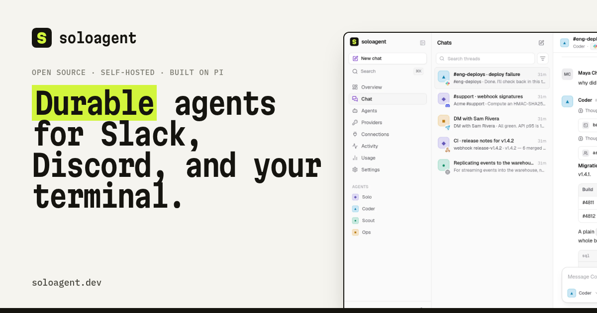

<p align="center">
  <picture>
    <source media="(prefers-color-scheme: dark)" srcset="assets/logo-dark.svg">
    
  </picture>
</p>

<p align="center">
  <b>All your agents. One control plane.</b><br>
  Durable AI agents on the subscriptions you already pay for — answering in Slack, Discord, Telegram, webhooks, the web, and your terminal.
</p>

<p align="center">
  <a href="https://soloagent.dev">soloagent.dev</a> ·
  <a href="https://soloagent.dev/docs/">Docs</a> ·
  <a href="#deploy-on-railway">Deploy on Railway</a> ·
  <a href="#terminal-ui">Terminal UI</a>
</p>

<p align="center">
  
</p>

---

soloagent is an open-source, self-hosted home for your AI agents. Give each agent a name, a personality, a model, and skills; then talk to all of them from wherever your team already is. It is built on **[Pi](https://github.com/earendil-works/pi)** — `@earendil-works/pi-ai` for model access and **`@earendil-works/pi-durable`** for durable execution — so every model turn and tool call is committed to storage *before* it is shown. Crash it, redeploy it, kill the container mid-answer: runs pick up where they stopped.

## Highlights

- **Durable by default.** Conversations, model turns, tool calls, reminders, and delegations live in Pi Durable's SQLite storage. A restart resumes unfinished work; a reminder set for next Tuesday fires next Tuesday.
- **Bring any subscription.** Sign in with **Claude Pro/Max**, **ChatGPT**, **GitHub Copilot**, **SuperGrok**, OpenRouter, and more via OAuth — or paste API keys for 30+ providers (Anthropic, OpenAI, Gemini, Mistral, Groq, DeepSeek, xAI, Bedrock, Azure, Vercel AI Gateway, …). Each agent can run on a different one. Credentials are sealed with AES-256-GCM.
- **Everywhere your team talks.**
  - **Slack** — Socket Mode (no public URL); @mention in a channel and the reply streams into the thread; DMs too.
  - **Discord** — mentions, replies, DMs; each thread is its own conversation.
  - **Telegram** — DMs, groups, forum topics.
  - **Webhooks** — synchronous answers or `callback_url`.
  - **Web dashboard** and **terminal UI**, both live.
- **Agents that work together.** Skills an agent can be granted:
  - `memory` — remember / recall / forget across every conversation
  - `web` — `web_fetch`, `web_search`
  - `delegate` — `ask_agent` hands a task to another agent through a durable child conversation
  - `schedule` — durable reminders and follow-ups that survive restarts
  - `workspace` — read / write / edit / bash in a private folder (powerful; off by default)
- **Steer mid-run.** Messages sent while an agent works are folded into the running work instead of waiting.
- **A real GUI and a real TUI.** A fast dashboard (chat with streaming, thinking, and tool cards; agent editor; subscription logins; connector setup with guides; live task graph; usage and cost) and a full-screen terminal UI built on `pi-tui`.
- **Try it with zero accounts.** A built-in demo model answers until you connect a provider.

## Quick start

```bash
git clone https://github.com/nearbycoder/soloagent.dev && cd soloagent.dev
npm install
npm run build        # builds the web GUI
npm start            # http://localhost:7420 — the admin token is printed on start
```

Or open the terminal UI, which runs a private server in-process (`~/.soloagent`):

```bash
npm run tui
```

Then sign in to a model provider from the dashboard's **Providers** page, or in the terminal with `/login anthropic`. Your default agent, `@solo`, switches from the demo model to the real one automatically.

> Requires Node.js 22.19+ (the server uses `node:sqlite` and runs TypeScript directly).

## Deploy on Railway

soloagent is a single service with a volume.

1. Create a new Railway project from this repo (**New → GitHub Repo → `nearbycoder/soloagent.dev`**). The included `Dockerfile` and `railway.json` are picked up automatically.
2. Add a **volume** mounted at `/data`.
3. Set variables:

   | Variable | Purpose |
   |---|---|
   | `SOLOAGENT_TOKEN` | Admin token for the dashboard, TUI, and API. Generate one: `openssl rand -base64 32` |
   | `SOLOAGENT_SECRET` | Seals provider credentials and bot tokens at rest. Keep it stable. |
   | `SOLOAGENT_DATA_DIR` | Optional. Defaults to the Railway volume mount. |
   | `SOLOAGENT_DEMO` | Optional. `0` hides the built-in demo model. |

4. Generate a domain, open it, and paste your token.

Connect your terminal to it:

```bash
soloagent connect https://your-solo.up.railway.app --token "$SOLOAGENT_TOKEN"
```

> **OAuth on a remote server.** Subscription logins redirect to `localhost` on the machine that started them. When the server runs on Railway, the dashboard shows a paste box — copy the final redirect URL (or code) from your browser and paste it in.

## Connect chat apps

Open **Connections** in the dashboard; each connector has a step-by-step guide.

| | What you need |
|---|---|
| **Slack** | Create an app from the bundled manifest, enable Socket Mode, and paste the `xapp-…` app token (scope `connections:write`) and `xoxb-…` bot token. Invite the bot to a channel and mention it. |
| **Discord** | A bot token with the *Message Content* intent enabled; invite it with the `bot` scope. |
| **Telegram** | A bot token from @BotFather (`/newbot`). |
| **Webhook** | A shared secret. `POST /api/hooks/<id>` with `x-solo-secret` and `{ "text", "thread", "user", "callback_url"? }`. |

In any chat: `@coder fix the build` or `coder: fix the build` picks an agent; otherwise the connector's agent (or the default) answers. Commands: `!agents`, `!reset`, `!stop`, `!help`.

## Terminal UI

```
soloagent                     open the terminal UI (embedded server, or your remote)
soloagent ask "<message>"     ask once and print the answer   (--agent, --thread, --json, "-" = stdin)
soloagent login [provider]    sign in with a subscription      (--key for API keys)
soloagent serve               run the server in the foreground
soloagent connect <url>       use a remote server              (--token)
soloagent agents | threads    list things
soloagent token               print the local admin token
```

Inside the TUI: <kbd>Enter</kbd> send (steers while busy) · <kbd>Shift</kbd>+<kbd>Enter</kbd> newline · <kbd>Esc</kbd> stop · <kbd>Ctrl</kbd>+<kbd>P</kbd> threads · <kbd>Ctrl</kbd>+<kbd>N</kbd> new · <kbd>Ctrl</kbd>+<kbd>B</kbd> sidebar · <kbd>Ctrl</kbd>+<kbd>T</kbd> thinking · <kbd>Ctrl</kbd>+<kbd>O</kbd> tool output · `/new @agent`, `/agent`, `/model`, `/login`, `/threads`, `/reset`, `/compact`, `/usage`, `/help`.

```bash
git diff | soloagent ask - --agent reviewer
```

## SDK and API

Everything the GUI and TUI do goes through a typed client:

```ts
import { SoloClient } from "@soloagent/client";

const solo = new SoloClient({ baseUrl: "https://your-solo.up.railway.app", token: process.env.SOLOAGENT_TOKEN });
const thread = await solo.createThread({ agentId: "coder" });
const { answer } = await solo.ask(thread.id, "What changed in the last deploy?");

const stream = solo.connect();
stream.subscribe(thread.id);
stream.on((event) => event.type === "thread.live" && console.log(event.live.partial?.text));
```

Or embed the runtime directly:

```ts
import { SoloAgent } from "@soloagent/core";

const solo = await SoloAgent.open({ dataDir: "./.data" });
const thread = await solo.createThread({ source: "api" });
const sent = await solo.send(thread.id, { text: "hello", author: { name: "me", source: "api" } });
console.log(await sent.wait());
```

REST routes live under `/api` with `Authorization: Bearer <token>`: `agents`, `threads` (`/messages`, `/ask`, `/stop`, `/reset`, `/compact`), `providers` (`/login`, `/key`), `connectors`, `schedules`, `usage`, `overview`, and the WebSocket at `/api/ws`. See the [docs](https://soloagent.dev/docs/).

## Architecture

```
 Slack · Discord · Telegram · Webhooks · Web GUI · TUI
                         │
            ┌────────────▼─────────────┐
            │  @soloagent/server        │  Hono REST + WebSocket
            │  @soloagent/core          │  router · agents · threads · connectors · skills
            │   └ Pi Durable Harness    │  durable conversations, tasks, tools  (SQLite)
            └────────────┬─────────────┘
                         │  @earendil-works/pi-ai
      Claude · ChatGPT · Copilot · Gemini · OpenRouter · 30+ providers
```

| Package | |
|---|---|
| `packages/core` | The runtime: Pi Durable harness, agents, threads, skills, connectors, credential sealing |
| `packages/server` | HTTP + WebSocket API, serves the GUI |
| `packages/client` | Wire protocol types and the typed SDK used by the GUI and TUI |
| `packages/web` | The dashboard (React 19, Vite, Tailwind 4) |
| `packages/cli` | The `soloagent` CLI and terminal UI (pi-tui) |
| `site/` | soloagent.dev |

## Development

```bash
npm install
npm run dev          # server with --watch on :7420 (SOLOAGENT_TOKEN=devtoken recommended)
npm run dev:web      # Vite dev server for the GUI (proxies /api)
npm test             # end-to-end runtime tests on Pi's faux provider
npm run typecheck
npm run build:npm    # bundle the publishable `soloagent` package into dist/npm
```

## Security

- Every API call needs the admin token; the dashboard keeps it in an httpOnly cookie.
- Provider credentials and bot tokens are sealed with AES-256-GCM using `SOLOAGENT_SECRET`, or a generated secret in the data directory.
- The `workspace` skill runs shell commands in a per-agent folder inside the server's container. Grant it only to agents you trust, on a deployment you're comfortable with.
- Third-party subscriptions have their own terms. Use subscription logins for your own personal use.

## License

MIT © Josh Hamilton and contributors. Built on [Pi](https://github.com/earendil-works/pi) by Earendil. Provider and product names are trademarks of their respective owners.
